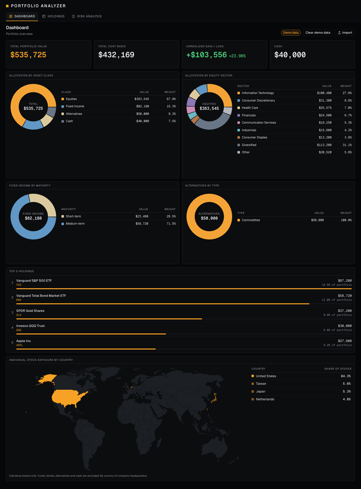
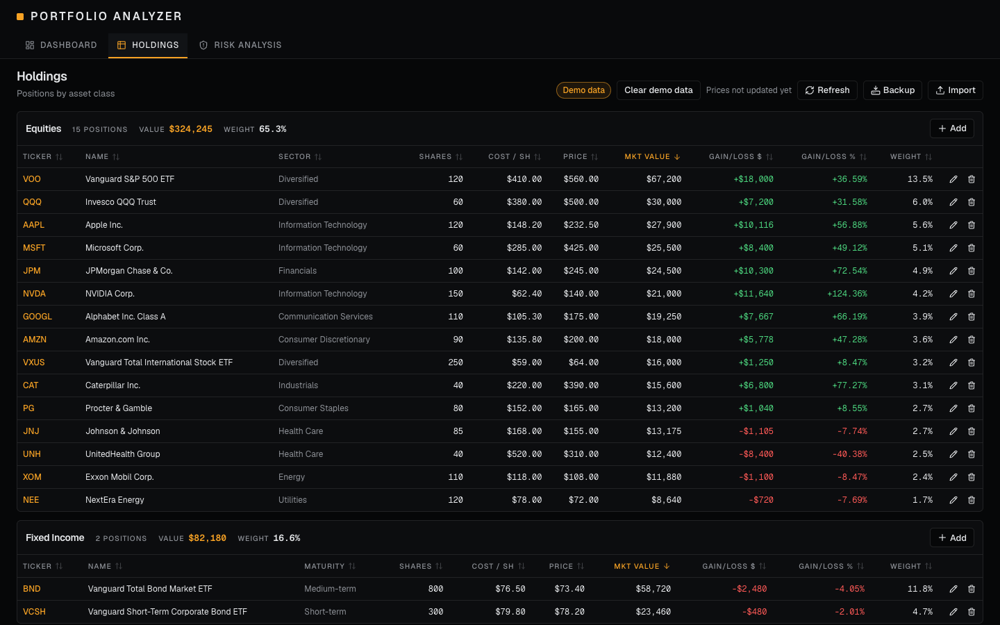
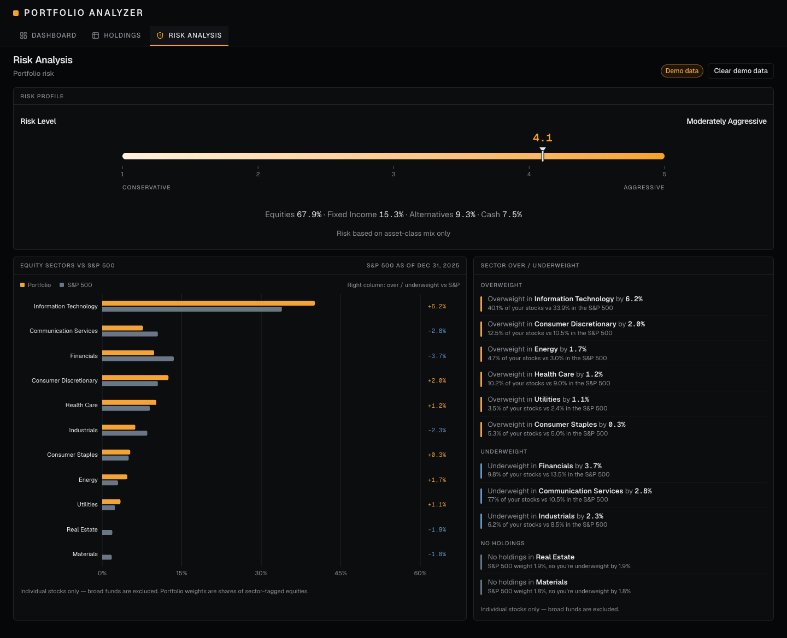

# Portfolio Analyzer

**Version 1.2** — A dark, terminal-style web app for analyzing an investment portfolio: allocation, sector tilts
versus the S&P 500, a risk profile, and a full holdings ledger, with automatic prices and CSV / Excel / screenshot import.

Each visitor's portfolio is saved **in their own browser**: no accounts, no login, and no server database, so
nobody can see or change anyone else's portfolio.



| Holdings | Risk Analysis |
|---|---|
|  |  |

_Screenshots show the built-in demo portfolio (illustrative numbers, not advice)._

## What it does
- **Dashboard** — portfolio value, cost basis, unrealized gain/loss and cash; allocation by asset class, equity sector, fixed-income maturity and alternatives type; top holdings; and a **world map of exposure by country** (SVG from Natural Earth data, shaded from faint to full amber, with a hover tooltip and a country list). ETFs are looked through: the sector chart and the map split each ETF across its underlying sectors and countries (bond funds count in the map too).
- **Holdings** — sortable tables for Equities, Fixed Income and Alternatives, plus a cash card. Add, edit and remove with validation; a Country column shows where each stock's company is based ("Diversified" for ETFs); adding a ticker you already hold offers to average it in or replace it.
- **Automatic prices** — every holding's price refreshes from [Financial Modeling Prep](https://site.financialmodelingprep.com) (every 2 minutes while the app is open, or with the **Refresh** button). A ticker with no price keeps the value you entered and is quietly marked "manual".
- **Autofill** — typing a ticker in the Add form fills the name and price; for stocks also the sector (an ETF is filed under "Diversified"), and for bond and alternatives funds the maturity or type.
- **Fund library** — a built-in list of 40 well-known bond and alternatives funds (maturity, duration, type) answers instantly and for free. Funds not in it are looked up by Claude with web search, and the answer is remembered in your browser.
- **Risk Analysis** — a 1 to 5 Risk Profile meter (scored from the asset-class mix) and equity sector weights (ETFs included, split by sector) versus the S&P 500, with a plain-English over/underweight summary.
- **Import** — CSV and Excel (flexible column matching, manual mapping) and screenshots or PDFs read by Claude, always with a preview before anything is saved. CSV/Excel files get an automatic Claude sanity check.
- **Backup** — download your portfolio as a file and restore it later or on another browser or device.
- **Demo portfolio** — every new visitor starts with a ~$500K sample portfolio, clearly badged and removable in one click.

## How your data is stored
Your holdings, cash and prices live in your browser's own storage on the device you use. The server never stores
them. Because of that:
- Clearing your browser data, or opening the app in another browser or device, starts you on a fresh demo portfolio. **Use Backup** (Holdings page) to keep a copy or move it.
- Some browsers (for example Safari on iPhone) can clear a site's saved data after a week or so of not visiting, so keep a backup file of anything you care about.
- The only things that leave your browser are the tickers sent for price lookups, and anything you ask Claude to read or look up (a screenshot, a fund name).

## Tech stack
Next.js (App Router) · TypeScript · Tailwind CSS · shadcn/ui · Recharts · SheetJS · Claude API (Anthropic SDK) ·
Financial Modeling Prep · d3-geo + Natural Earth (world-atlas) for the map · browser `localStorage` · Vitest

## Run it locally
Requires Node.js 20+.

```bash
npm install                 # install packages
cp .env.example .env.local  # local settings
# optional: add ANTHROPIC_API_KEY to .env.local to enable screenshot/PDF import, Claude checks and fund lookups
# optional: add FINANCIAL_MODELING_API_KEY to .env.local to enable automatic prices and ticker autofill
npm run dev                 # open http://localhost:3000
```

Without the keys the app still works: you enter prices by hand and the built-in fund library still fills in maturities and types.

Other commands: `npm test` (unit tests), `npm run typecheck`, `npm run lint`, `npm run build`.

## Deploy your own copy (Vercel)
1. Import this repository into [Vercel](https://vercel.com) (the free Hobby plan is for personal, non-commercial use).
2. Add the two keys as **Environment Variables** (exact names, never prefixed with `NEXT_PUBLIC_`): `ANTHROPIC_API_KEY` and `FINANCIAL_MODELING_API_KEY`.
3. Deploy, and redeploy after changing a variable.

**Costs and limits to know about:** the keys live on the server and are used for every visitor's lookups, so whoever
deploys the app pays for them. Financial Modeling Prep's Starter plan allows 300 calls a minute (the free plan only about 250 a day, which the
automatic refresh would use up quickly; raise `PRICE_REFRESH_MINUTES` if you stay on it). One price refresh is
one call per holding for every open tab (plus 1 to 2 calls per ETF or bond fund about once a week for its sector and country weights), and each Claude fund lookup costs a few cents. Set a monthly spending limit with your API
provider, and keep the link private if you don't want strangers using your keys.

## Releases
Releases are tagged on GitHub. The current release is **v1.2**.
- **v1.2** — ETF look-through: the equity sector chart, the Risk sector comparison and the country map now split each ETF across its underlying sectors and countries (bond funds count on the map too), with an "Unclassified" slice for missing data. Fund weights are saved in your browser and refreshed weekly.
- **v1.1** — Country column for stocks (ETFs show "Diversified") and the **Individual Stock Exposure by Country** world map on the Dashboard; prices refresh every 2 minutes.
- **v1.0** — browser-based private portfolios, automatic prices and autofill, the fund library, backup and restore, and the Risk Analysis tab.

## Project docs
- [`docs/SPEC.md`](docs/SPEC.md) — what the app is and where it's heading
- [`CLAUDE.md`](CLAUDE.md) — conventions for AI-assisted development

_This is a personal analysis tool. Nothing in it is investment advice, and prices come from a third-party service._
